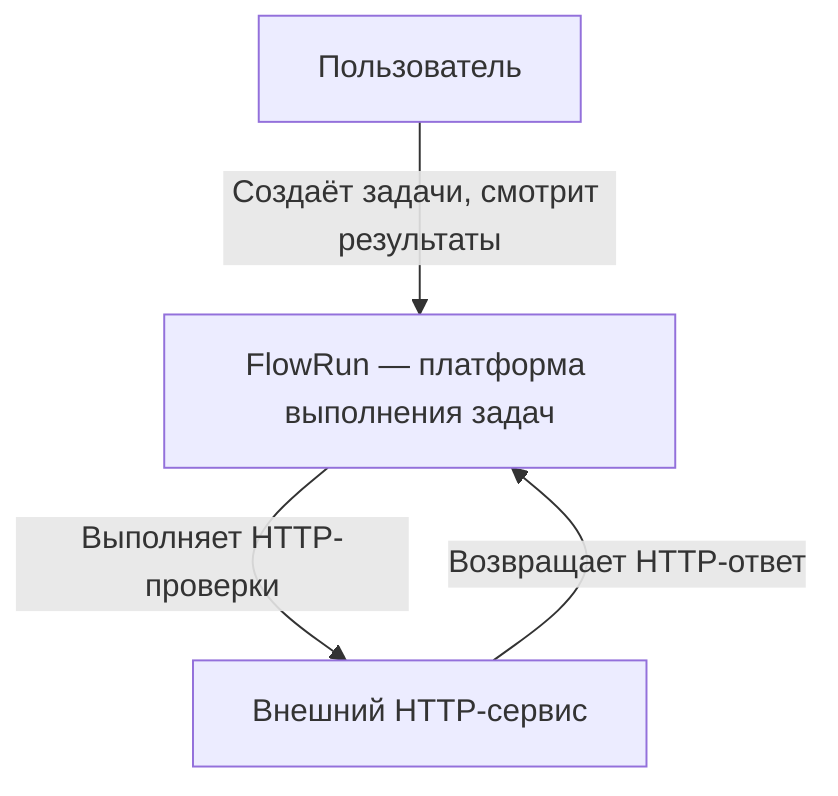

# C1 — System Context

Диаграмма показывает FlowRun в окружении пользователя
и внешних HTTP-сервисов.

## Описание

Пользователь создаёт задачи и управляет их выполнением.

FlowRun планирует и выполняет задачи, сохраняет результаты
и предоставляет информацию о выполнении.

Внешний HTTP-сервис — объект проверки.

## Граница доверия

Пользователь взаимодействует с публичным интерфейсом
FlowRun. Доступ к внутренним сервисам и хранилищам
должен быть ограничен.

HTTP-проверки выполняются только для разрешённых адресов.
