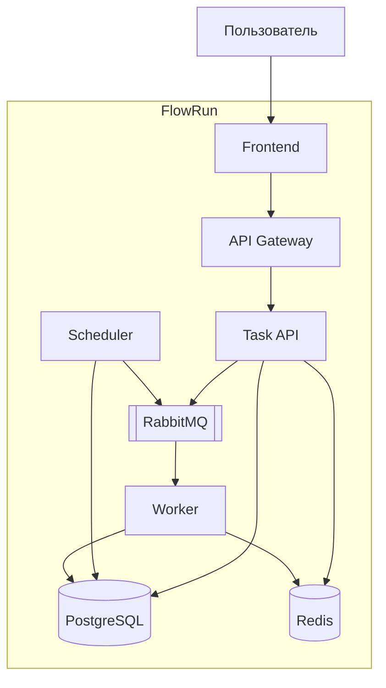

# C2 — Container Diagram

Диаграмма контейнеров целевой архитектуры FlowRun.

## Компоненты

| Компонент | Назначение |
|-----------|------------|
| Frontend | Веб-интерфейс управления задачами |
| API Gateway | Маршрутизация HTTP-запросов |
| Task API | Создание и управление задачами |
| Scheduler | Планирование и отправка заданий |
| Worker | Выполнение фоновых задач |
| PostgreSQL | Хранение задач и результатов |
| Redis | Кэширование данных |
| RabbitMQ | Передача заданий между сервисами |

